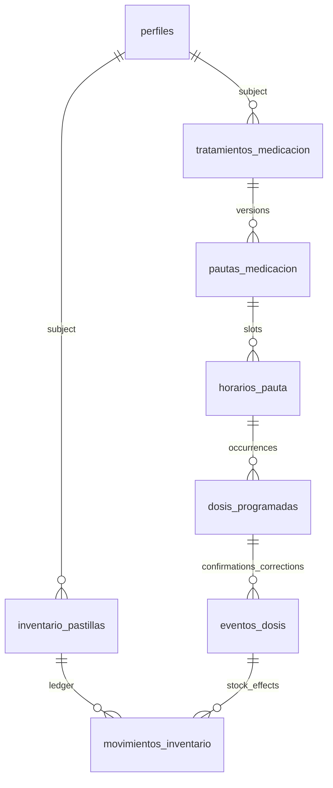

# A database model for reliable Vita actions

**Status: proposal prepared for review, not an applied schema.** Preserve the current identity system and typed health records; introduce explicit treatment, schedule, expected-dose and stock-event identities. UI, chat and notification actions must use the same authorized operations and report confirmed results. The user authorized preparing this proposal; the product choices below are not approved.

## What this changes for a person using Vita

“I take this at 08:00 and 20:00” becomes one treatment with two scheduled occurrences. “I took the morning dose” identifies a concrete dose, records the confirmation and its stock effect once. Changing tomorrow's schedule preserves what was expected and recorded yesterday.

The first implementation should deliver that complete medication journey, including permissions and recovery. Adding tables without adapting tools and screens would leave the agent operating on the old model.

## Current baseline and evidence

The [baseline report](database-baseline.md) records the owner-supplied production metadata and controlled local reconstruction: PostgreSQL 17.6, production versions 001–030, matching object counts and 18 routine hashes. This was a scoped comparison, not a complete automated equivalence proof. Local SQL tests produced 14 passes and three recorded failures.

| Current evidence | Design implication |
| --- | --- |
| [001](../supabase/migrations/001_initial_schema.sql): each medication row contains its hour; takes are unique by medication/date and cascade on medication deletion. | Separate treatment, schedule and dated occurrence; ordinary archival must preserve history. |
| [014](../supabase/migrations/014_inventario_pastillas.sql): inventory groups by normalized person/name/dose and uses integer quantities. | Preserve inventory IDs, support physical fractions, replace name-based identity with explicit relationships. |
| [021](../supabase/migrations/021_familia.sql): accepted caregivers read; role `editar` writes through policies/helpers. | Preserve the permission model and recheck it for every effective action. |
| [Medication nucleus](../apps/web/src/lib/medicamentos/nucleo.ts): lookup by name, date helpers and take/stock writes are separate concerns. | Resolve ambiguity explicitly and transact domain effects together. |
| [Tools](../apps/web/src/lib/ai/tools.ts) have medication, appointment, profile and navigation operations, but no measurement/study tools. | Database availability and agent capability must be tracked separately. |
| [030](../supabase/migrations/030_acciones_agente.sql) already defines action deduplication and is registered in production. | Evolve it through new migrations; never replace its historical CREATE TABLE. |

The [current model reference](data-model.md) contains historical descriptions. Current migrations and nuclei take precedence when a description conflicts with them. Pending memory and other PR branches remain separate inputs, not integrated capabilities.

## 1. Keep identity stable; distinguish actor and subject

Keep `auth.users` ↔ `perfiles` and `vinculos_cuidador`. A managed person already has that identity; this design does not introduce a second authentication system or migrate everyone to a new `personas` table.

| Concept | Proposed contract |
| --- | --- |
| Actor | Authenticated session user, obtained from `auth.uid()`; never trusted from AI input. |
| Subject/person | Existing clinical `usuario_id`; an API parameter may call it `persona_id` for clarity. It can differ from the actor. |
| Author/source | Record `creado_por`, `origen` and timestamps for actions and clinical additions where provenance matters. Service work identifies its originating authorized action. |
| Caregiver | A current accepted link with the required `ver`/`editar` role. A link is not blanket consent for every notification or memory use. |
| Same-person relationship | Parent and child must share the subject, independently of the caller's visibility. |

For example, `(medicamento_id, usuario_id)` must reference a matching parent key, rather than two unrelated foreign keys. The same rule applies to dose/inventory and message/session relationships. Candidate parent keys include `UNIQUE(id, usuario_id)`; nullable links need an explicit nullability contract.

RLS answers who may access a row; foreign keys answer which rows may be related. Use both. Cross-table invariants belong in suitable FK/UNIQUE constraints and transactional operations, not CHECK functions that query other tables. [PostgreSQL constraint documentation](https://www.postgresql.org/docs/17/ddl-constraints.html).

## 2. Medication core: distinct identities for distinct facts

Names below are proposed logical tables. Final column types, enums and physical DDL belong to the implementation slice after the open decisions are resolved.

| Entity | Important fields and keys | Invariant |
| --- | --- | --- |
| `tratamientos_medicacion` | Stable `id`, `usuario_id`, display name, presentation/strength when known, lifecycle, provenance. | A name is a label, not a universal identity. Two legitimate treatments can have similar names. |
| `pautas_medicacion` | `id`, treatment/subject FK, version, effective interval, indications, prescriber label/source. | Versions do not overlap for the same active treatment; changing a pauta creates a version. |
| `horarios_pauta` | `id`, pauta/subject FK, stable `slot_clave`, local time, recurrence, clinical dose and unit, optional inventory/physical consumption quantity. | Amounts may differ between slots. Clinical mass and physical stock units are separate. |
| `dosis_programadas` | Stable `id`, subject/treatment/slot/version FKs, local date/time, timezone, expected instant, immutable dose/consumption snapshot, cancellation/replacement metadata, `estado_actual` and `revision`. | At most one active expected dose for a subject/treatment/slot/date; generation is idempotent. Current state/revision are mutable projections backed by events and changed in the same RPC transaction. |
| `eventos_dosis` | `id`, dose/subject FK, actor, event type, effective/recorded times, action ID, expected previous revision, optional corrected-event ID. | Confirmation and correction are explicit facts; corrections preserve the earlier event. |
| `inventario_pastillas` | Preserve `id` and subject; explicit physical unit, numeric balance/threshold, count provenance, balance revision. | A stock item is identified explicitly, not recomputed from the latest medication name. |
| `movimientos_inventario` | `id`, inventory/subject FK, dose-event FK when applicable, signed physical quantity, reason, source/action ID, optional reversed-movement ID. | At most one movement per dose event/inventory, enforced by a unique pair. A reversal uses the original quantity and cannot be applied twice to the same movement. |

The current single-inventory dose model needs only one stock movement per event. Multiple movements for one event require different inventory IDs and an explicitly supported representation; retries cannot create another movement for the same pair. A non-null reversed-movement reference must be unique, with its quantity checked against the original movement in the transaction. Non-dose movements require an equivalent unique source/action identity.

Examples: “500 mg” is a clinical dose; “0.5 tablet” or “5 mL” is a physical consumption quantity. Neither can be inferred from the other without a verified formulation/conversion. Unknown legacy dose text remains text with its provenance until reviewed.

Use numeric quantities with validated units and finite, bounded values; do not use floating-point balances. The precision and supported units are implementation decisions based on actual forms, not a promise to support every formulation immediately.

Initial index candidates follow actual reads: subject/date and active state for expected doses, dose/event order for confirmations, inventory/event order for movements, and actor/request/action key for retries. Preserve FK-supporting indexes and check query plans on representative synthetic data before adding broader JSON or text indexes.

### Time and history

- Store the expected dose's local date, timezone and instant separately from the actual intake instant and recording instant. Argentina remains the current scheduling convention; adding other timezones requires an explicit product contract.
- Generate occurrences over a bounded configurable horizon. A missing generated row is not proof that no dose was due; completion/reconciliation of generation must be observable.
- Keep the expected name, dose, quantity and schedule-version snapshot immutable. Lifecycle fields may record cancellation/replacement through authorized operations.
- A future edit cancels eligible unconfirmed future occurrences and creates replacements under the same stable slot identity. A uniqueness rule for active occurrences and treatment-level serialization must prevent two live replacements. Confirmed occurrences are not silently regenerated.
- Absence of confirmation, explicit omission, cancellation, pause and completion are distinct. “Overdue” is derived from the expected instant and applicable confirmation window; it is not proof of non-adherence.
- Ordinary treatment archival stops future generation and preserves prior doses/events. Account deletion and legally/product-defined retention are separate operations, not accidental medication cascades.

Existing `frecuencia` and `duracion` are descriptive. Do not turn them into recurrence or an automatic stop date through AI interpretation during migration; explicit structured instructions require review.

### Intake and stock form one transaction

Proposed shared operation: `confirmar_dosis(persona_id, dosis_id, pedido_id, revision_esperada, ...)`. This is a domain contract, not an existing RPC.

1. Resolve the actor from the session; validate the subject, dose and current edit permission.
2. Claim/resolve the action's idempotency identity and lock the affected domain rows in a documented consistent order.
3. Check the expected dose revision/state; append the confirmation or correction event once and update its `estado_actual`/`revision` projection without rewriting the expected snapshot.
4. Append its physical stock movement and update the balance consistently, or use the explicitly approved shortage/reconciliation outcome.
5. Persist the effective action result in the same database transaction; return stable IDs, resulting state, revisions and any unresolved reconciliation.

A database failure rolls back all domain effects. A retry after commit returns the stored result. Provider calls and push delivery stay outside this transaction. PostgreSQL row locks can coordinate concurrent updates, but the implementation must prove lock ordering and conflict behavior. [PostgreSQL locking documentation](https://www.postgresql.org/docs/17/explicit-locking.html).

Guarded RPCs and grants must prevent clients from bypassing these invariants through independent table updates. Existing direct CRUD cannot remain an alternate route to inconsistent events and balances. Preserve normal user authorization; do not solve this by routing ordinary actions through `service_role`.

**Shortage recommendation, not yet approved:** do not reject a truthful intake report solely because recorded stock is insufficient. Record an explicit reconciliation outcome with the intake, rather than silently clamping away the discrepancy. Whether to retain a pending movement or another accounting representation must be settled before its DDL/RPC is implemented.

## 3. Health records remain structured sources of truth

| Area | Preserve | Proposed evolution |
| --- | --- | --- |
| Measurements | `mediciones`, type-specific validation, actual measurement timestamp. | Author/source, explicit units and controlled context; shared validated write/read operations for UI and tools. |
| Studies | `estudios`, protected file storage, original extracted values. | Separate extraction draft/raw evidence from reviewed findings; candidate `resultados_estudio` rows carry parameter, numeric/text value, unit and printed range/source. |
| Consultations/vaccines | Typed `consultas` and `vacunas` tables with dates/origin. | Complete their authorized entry/read journeys; table existence does not imply a working UI or chat tool. |
| Appointments/prescriptions | `turnos`, checklist details and `recetas`. | Stable subject/provenance, validated date/time, links to resulting consultation or document only when known. |
| Conditions/allergies | Existing profile values and their original wording. | Candidate `condiciones_persona`/`alergias_persona` with IDs, status, source and recorded dates; preserve raw legacy values and review ambiguous matches. |

A unified read projection can combine dated entries for the feed and agent context while keeping domain-specific tables. A view must preserve the caller's RLS through `security_invoker=true`, or access must use an explicitly authorized RPC; an owner-privilege view is not an authorization shortcut. [PostgreSQL view documentation](https://www.postgresql.org/docs/17/sql-createview.html). Avoid one unrestricted JSON “health facts” table that hides units, provenance and authorization differences.

AI extraction creates a validated draft. The user reviews required fields before authoritative clinical persistence. “Reported by the user,” “printed in a study,” and “inferred by AI” must remain distinguishable. Do not invent clinical reference ranges or let Vita autonomously prescribe/change a clinical dose.

Answers about a measurement or study must include its date/source and distinguish unavailable information from a successful empty search. Retrieving a file or its values requires the current subject permission, not possession of an old URL alone.

## 4. Agent actions have durable intent and effective outcomes

Evolve existing `acciones_agente` through additive migrations. Preserve its `(usuario_id, pedido_id, clave)` deduplication behavior until the replacement contract and compatibility adapter are proven.

| Proposed action data | Purpose |
| --- | --- |
| Actor, subject and conversation/request IDs | Separate who asked, whose data changes and which retry is being resolved. |
| Operation/version, canonical target IDs, validated payload fingerprint | Resolve the exact intent; a similar medication name is not an accepted identifier. |
| State, revision, expiry and confirmation binding | Represent proposed, awaiting confirmation, executing, applied, rejected, expired and recovery-required outcomes. |
| Effective result and domain-event IDs | Distinguish a tool request from an actual committed effect. |
| Created/confirmed/applied times and bounded error code | Explain progress and recovery without an unbounded health-data log. |

Bind confirmation to the actor, subject, conversation, operation, payload/version and expiry. Revalidate permissions and current domain state when consuming it; approval does not survive arbitrary target changes or revocation. Consumption and the domain write must not race into duplicate effects.

Action payloads, snapshots and results can contain health information. Their RLS, allowed columns and purpose-specific retention must be explicit, including migration/reconciliation records. Keep action ownership with the actor and recheck access to the subject before returning a cached clinical result after revocation; idempotency is not a permission bypass. Do not retain raw provider inputs indefinitely as an audit mechanism.

An ambiguous match returns candidates for clarification. A stale action returns a conflict; it never silently applies to a different dose or current date. Vita receives typed operations through the shared nuclei, never arbitrary SQL or unrestricted table names.

### Capability contract

This matrix describes the inspected main baseline. Proposed endpoints are not implemented tools.

| Capability | Current position | Required target contract |
| --- | --- | --- |
| Medication read/write | Existing tools and shared nucleus; identity/time/stock limitations remain. | Read expected doses; write by stable dose/treatment IDs; confirm destructive or schedule changes according to the action contract. |
| Appointments | Existing add/today-list tools. | Keep dated subject-scoped reads/writes; explicitly specify any new modify/delete capability and confirmation. |
| Health profile | Existing profile/condition/allergy tools. | Preserve provenance and exact targets when structured condition/allergy IDs are introduced. |
| Measurements | Existing UI/nucleus; chat tools absent. | Add separate subject-scoped read/write tools with validation; do not promise chat persistence before integration. |
| Studies | Existing extraction/review UI and storage; chat tools absent. | Authorized dated findings read; extraction/review remains distinct from casual conversational inference. |
| Consultations/vaccines | Tables and feed reads exist; entry journeys incomplete. | Decide the product flow and add its nucleus/UI/tool together. |
| Navigation | `open_screen` exists. | Opening a screen does not mean reading or writing its records succeeded. |
| Memory | Implemented in pending PRs, not the inspected main. | Integrate only after the privacy/recovery contract below is proven. |

All mutations return `aplicada`, `sin_cambio`, `requiere_confirmacion`, `conflicto` or a typed failure, plus effective identifiers. UI refresh uses that result and verifies the new projection; a generated sentence is not proof of persistence.

## 5. Notices, memory and consent refer to the right facts

### Notices

Keep the current feed, subscriptions and preferences while introducing separate event, authorized-recipient and channel/device-attempt records. Suggested logical identities are `eventos_avisos`, `destinatarios_avisos` and `intentos_envio`.

An attempt records its event/dose ID, recipient/subscription, state, attempt count, lease expiry, provider acceptance and bounded error/uncertainty. A worker can recover an expired reservation; an uncertain provider result needs a policy that acknowledges possible duplicate delivery. Database deduplication alone does not guarantee exactly-once transport.

Accepted by a provider, displayed by a device and read/acted on by a person are distinct observations. Notification actions carry the exact dose/event ID and recheck session, subject permission, event validity and current state. A yesterday notification must not mark today's dose.

Recipient permission and notification-purpose preference are evaluated at delivery/action time. Logout, account switching and caregiver revocation must invalidate the relevant subscription/recipient authority; any remaining device notification must not grant authority to act.

### Memory and consent

Keep real chat history. A memory belongs to its author/account; a mentioned family member is a separate reference, not automatic permission to share that memory or modify their clinical record.

“Forget” must be implemented across recent messages used as context, search, highlights, summaries and jobs in flight. Use an exclusion/revision mechanism that invalidates stale work, not merely deletion from one memory table. Visible conversation retention, forgetting contextual use and deleting clinical records need distinct user-facing operations.

Privacy preferences are owner-controlled; a caregiver's clinical edit role must not implicitly modify them. Third-party memory after unlink/account deletion, expiry semantics and export scope remain explicit product decisions.

Candidate consent records identify actor, subject, purpose, policy/version, grant/revocation time and authority basis. They document product behavior; this proposal does not establish legal sufficiency or assume an editor can grant every purpose for another person.

AI usage should also distinguish requested/estimated/confirmed consumption and uncertain provider outcomes across chat, extraction, voice and background jobs. Future reservation/accounting records need bounded recovery; expiry alone must not free money for an operation the provider may have completed. No model, tariff or budget is changed by this design.

## 6. Migrate existing data without inventing history

| Existing data | Candidate mapping | Reconciliation rule |
| --- | --- | --- |
| `medicamentos` rows | Treatment candidates, initial pauta and slot rows. | Persist each legacy ID mapping and evidence; shared name/dose/inventory is a grouping candidate, not permission to merge. |
| `medicamentos_tomas` | Known intake evidence and, when supported, a linked expected occurrence/event. | Retain original date and intake timestamp. Neither proves the historical scheduled date/pauta after edits. Preserve ambiguous/unmapped records for review. |
| `inventario_pastillas` | Existing stock identity, explicit unit, opening-count evidence. | Do not fabricate past stock movements to explain the current balance; distinguish unknown history from a measured opening count. |
| `acciones_agente` | Compatible action adapter plus later explicit state/subject columns. | Applied 030 evolves additively; old retries must not execute twice across the transition. |
| Profile JSON/arrays | Reviewed condition/allergy candidates with original payload. | No automatic semantic diagnoses, duplicate deletion or unsupported person links. |
| Notice references | Explicit legacy→dose/event mapping where determinable. | Reject or safely navigate ambiguous old actions; never substitute the current day's occurrence. |

Use a durable mapping/reconciliation ledger per legacy primary key and migration batch, including target IDs, source provenance, ambiguity and verification status. New identities must be deterministic/reusable within the migration so reruns do not duplicate records.

### Transition sequence and gates

| Stage | Work | Gate before proceeding |
| --- | --- | --- |
| Prepare | Settle blocking product choices; repair SQL test harness expectations; audit effective/default privileges; reserve new migration numbers against pending branches. | Current baseline and regression expectations recorded; no blanket `GRANT ALL` rollback. |
| Expand | Add the new core tables, ownership constraints and guarded operations alongside the old schema. | Local replay, RLS, uniqueness, transaction and retry tests pass; old application still runs. |
| Backfill | Map synthetic/historical-shaped fixtures and then a separately authorized real dataset with reconciliation. | Counts, provenance, ambiguous records and stock opening balances are explainable; no silent drops or collision deletion. |
| Integrate | Adapt shared nuclei, UI, tools, routine/adherence, cron and push actions through one compatibility boundary. | End-to-end scenarios pass against the same subject/dose IDs and actual persisted outcomes. |
| Switch | Select one authoritative writer for the affected person/treatment or use a coordinated write pause. | No uncontrolled old/new dual writers; pending actions and background jobs are compatible or drained. |
| Retire | Remove old write paths and later obsolete structures only after observation/reconciliation. | Recovery plan preserves writes made after switch; no unexamined cascading history loss. |

Rollback before the switch can leave additive tables unused. After new authoritative writes exist, recovery needs reverse mapping/replay or a forward repair with a controlled write boundary; reverting application code alone is insufficient. Preserve ACL evidence, original legacy rows and reconciliation records until the approved retention/cleanup point.

Do not apply the pending 032 backfill as a substitute for this analysis: converting intake instants into expected-dose dates or discarding collisions can lose meaning. No production migration, cron change or notification is authorized by this document.

## 7. Prove user journeys, not only table creation

The following are **proposed acceptance tests; none was executed against this proposed schema**. The existing baseline tests remain separate evidence.

| Scenario | Required observable result |
| --- | --- |
| One medication at 08:00 and 20:00 | One treatment, two slots, distinct expected doses and shared explicit stock identity. |
| Two tabs confirm the same dose | One accepted transition/stock effect; the other request resolves idempotently or reports a revision conflict. |
| Yesterday's dose is recorded after midnight | The intended expected dose retains yesterday's date; actual intake/recording times remain distinct. |
| Tomorrow's dose/quantity changes | A new pauta affects eligible future occurrences; past snapshots and adherence denominator remain unchanged. |
| A take is corrected after quantity changed | Reversal references the original movement and quantity, never today's pauta quantity. |
| Stock write fails or balance is insufficient | No partial silent success; rollback or the approved explicit reconciliation outcome is visible in the action result. |
| Child references another person's inventory/dose/session | Database relationship constraint rejects it even when a caller can view both people. |
| Reader/editor/unrelated/revoked caregiver acts | Reads and writes match current authority, including confirmation consumed after revocation. |
| Two medications match the spoken name | Vita requests a choice and records no medication mutation before resolution. |
| A stale push or confirmation is used | Exact old target is checked; no write is redirected to the current person/date or altered payload. |
| Vita answers about a measurement/study | A real read tool returns dated, sourced, authorized records; missing capability/data is represented honestly. |
| A remembered fact is forgotten during a summary job | Recent context, search, highlights, summary and job completion all honor the exclusion/revision. |

Add SQL constraint/RLS tests, multi-connection transaction tests and UI/chat/push integration tests at their actual boundaries. Source parsing, voice negations and actual device/provider delivery need separate fixtures/checks; SQL success does not cover them.

## Decisions needed before behavioral implementation

| Decision | Recommendation to review | What depends on it |
| --- | --- | --- |
| Treatment/duplicate identity | Stable IDs and explicit resolution; name similarity offers candidates. Define presentation/strength and intentional parallel courses. | Legacy grouping and add/update tool contract. |
| Late confirmation | Preserve expected dose identity and capture actual/recorded time separately; agree the permissible confirmation window. | Dose states, UI and reminder actions. |
| Insufficient stock | Accept truthful intake with an explicit reconciliation state; choose the accounting representation. | Transaction result, ledger/balance checks and reversal. |
| Pause/archive/finish | Separate effects on future generation from preserving historical records; decide handling of already due doses. | Schedule lifecycle and adherence. |
| Pauta changes | Version future instructions; agree effective-date and handling of already confirmed future occurrences. | Materialization/replacement and concurrency rules. |
| Consent and third-party memory | Explicit purposes/authority; decide unlink, deletion, expiry and export semantics. | Recipient rules, privacy controls and pending memory PRs. |

These are recommendations for the product owner, not adopted medical/legal policies. TDD mode for future SQL behavior also remains unresolved; it does not affect this documentation-only design.

## First implementation units

1. **Reliable foundation:** fix the three SQL test scripts, audit/restrict unnecessary authority and prove same-person relationships against synthetic malformed inputs. Keep each behavior change reviewable.
2. **Medication vertical slice:** introduce treatment/pauta/slot/dose/event/stock identities and one transactional operation; adapt the shared nucleus and a full UI/chat/push path together. Begin with approved current recurrence rules, not every hypothetical regimen.
3. **Health and agent integration:** add dated/source-aware measurement/study tools, then evolve durable action outcomes and notice recovery. Memory/consolidation follows its privacy gate; consultations/vaccines need their own authorized product journeys.

The design is ready for product decisions and bounded implementation planning. It has not changed the local or production schema, fixed the recorded SQL test failures or made proposed tools available to Vita.
